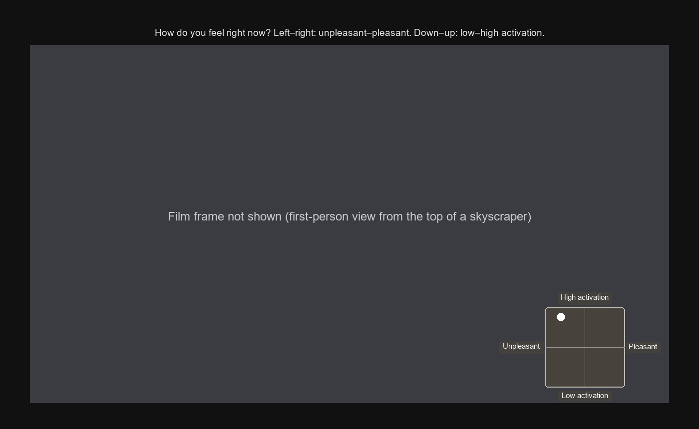
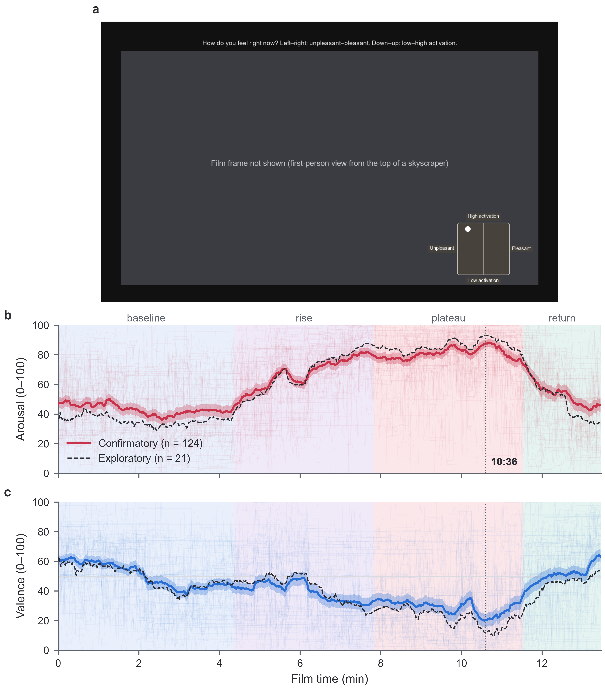
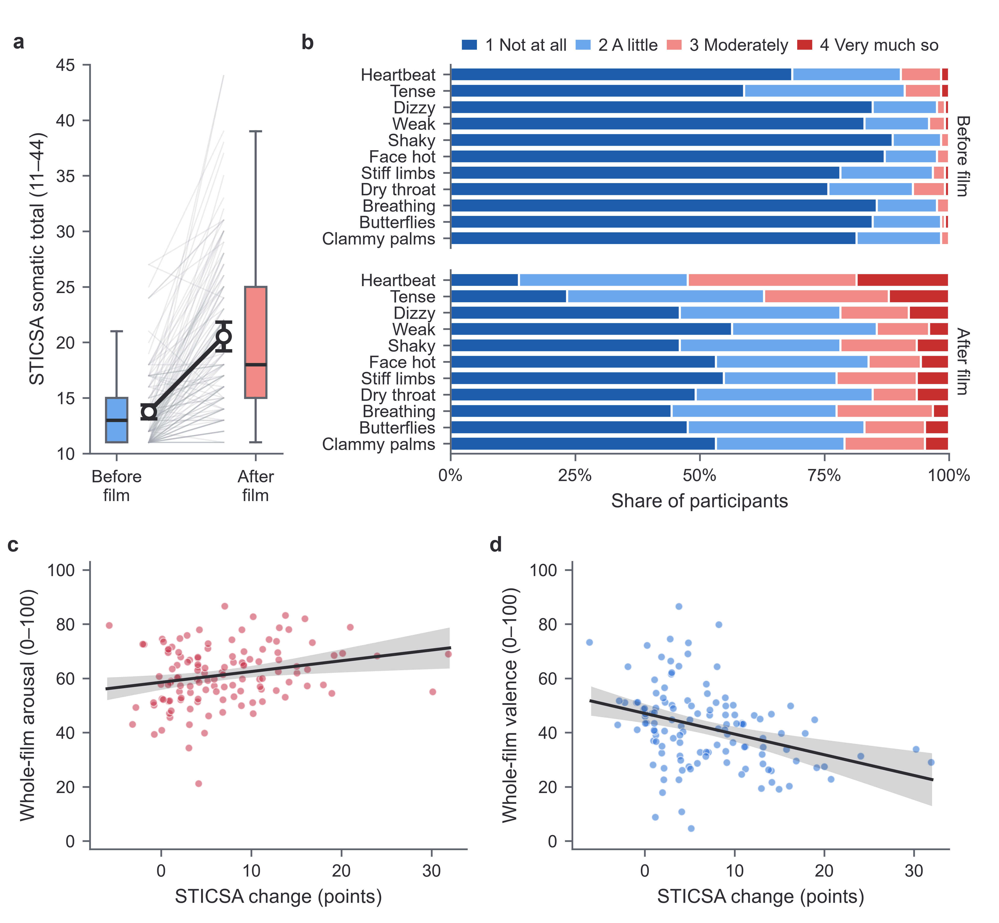
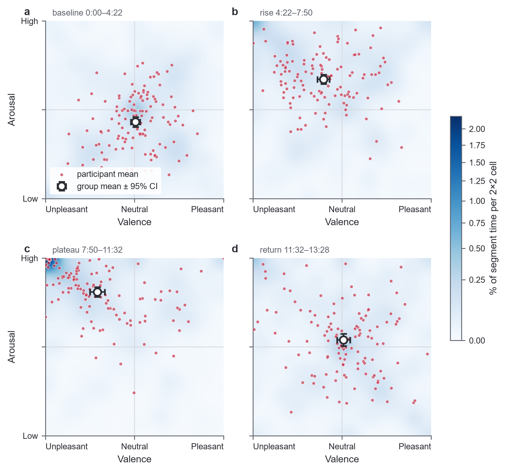

# Moment-to-Moment Affect During Film-Induced Somatic Anxiety

[](https://doi.org/10.5281/zenodo.23151387)
[](https://osf.io/s2yvb)
[](https://doi.org/10.31234/osf.io/szv9e_v3)

> **Please cite:** Allen, M. G. (2026). *Moment-to-moment affect during film-induced somatic anxiety* [Preprint].
> PsyArXiv. https://doi.org/10.31234/osf.io/szv9e_v3

<details>
<summary>BibTeX</summary>

```bibtex
@article{allen2026heights,
  title   = {Moment-to-Moment Affect During Film-Induced Somatic Anxiety},
  author  = {Allen, Micah G.},
  journal = {PsyArXiv},
  year    = {2026},
  doi     = {10.31234/osf.io/szv9e_v3},
  url     = {https://osf.io/preprints/psyarxiv/szv9e_v3}
}
```

</details>

To cite the data and code themselves, use the Zenodo archive
([doi:10.5281/zenodo.23151387](https://doi.org/10.5281/zenodo.23151387)). GitHub's "Cite this repository" button
(from [CITATION.cff](CITATION.cff)) gives both.

Micah G. Allen, Center of Functionally Integrative Neuroscience, Aarhus University
([ORCID 0000-0001-9399-4179](https://orcid.org/0000-0001-9399-4179)).

This repository holds the data, analysis code, study materials and manuscript.

## Abstract

Watching someone in danger can make a viewer feel anxious even when they know they are safe. Studying how this
response builds, persists and subsides requires methods that capture experience as events unfold. We present an
open-source browser platform for continuous affect rating and demonstrate its use with a 13.5-minute film of
unsecured skyscraper climbing. Viewers rate valence and arousal simultaneously on an affect grid embedded in the
video. The platform records ratings alongside video and displayed-frame timestamps, pauses playback during
interruptions, and combines participant training with input logging and checks on session quality. An exploratory
sample (*n* = 21) informed preregistered tests in an independent confirmatory sample (*N* = 124). Arousal rose as the
climb progressed, remained elevated for several minutes, and then declined, with the sustained period experienced as
most unpleasant. Group-level time courses closely reproduced across samples (arousal *r* = .993; valence
*r* = .937). Self-reported somatic anxiety increased substantially after viewing (*d*<sub>z</sub> = 1.03), and larger
increases were associated with higher arousal and more unpleasant valence during the film. The platform, analysis
code and reference data are openly available. Together, these resources support online characterisation of
naturalistic stimuli and provide a shared temporal reference for studying sustained emotion, bodily experience and
their physiological and neural correlates.

*Keywords:* emotion induction, continuous affect rating, affect grid, naturalistic stimuli, somatic anxiety,
interoception

## Links

- **Archive:** [doi:10.5281/zenodo.23151387](https://doi.org/10.5281/zenodo.23151387) (Zenodo; this DOI always
  points to the latest version; the current version is release v1.0.2).
- **Preprint:** [doi:10.31234/osf.io/szv9e_v3](https://doi.org/10.31234/osf.io/szv9e_v3) (PsyArXiv; manuscript
  and supplement, version 3, posted 2026-10-16).
- **Preregistration:** [osf.io/s2yvb](https://osf.io/s2yvb), registered 2026-10-04 (public).
  Text in [docs/preregistration.md](docs/preregistration.md); decisions and deviations in
  [docs/prereg_log.md](docs/prereg_log.md).
- **Rating task:** the exact task and study settings used are in [materials/rating_task/](materials/rating_task/).
  The general tool is [online-affect-rating](https://github.com/embodied-computation-group/online-affect-rating)
  (tag `v1.0-heights-film` = the version used here).
- **Data preparation:** the scripts that turned the raw results into `data/processed/` are in
  [data_preparation/](data_preparation/) (a record; the raw data contain Prolific IDs and are not shared).
- **Paper:** the preprint above; LaTeX sources of the manuscript and supplement in [manuscript/](manuscript/)
  (build with `latexmk -pdf manuscript.tex supplement.tex`).

## Figures

**The rating task (Online Resource 1, Fig. S2).** Participants moved a dot within the affect grid in the corner of the
video: left to right for unpleasant to pleasant, down to up for low to high activation. The film frame is not shown;
the grid is redrawn as in the task, and the dot is the confirmatory sample's mean rating at 10:36.



**Figure 1. The rating screen (a) and continuous arousal (b) and valence (c) over the film.** Thin lines are individual participants of the
confirmatory sample; the thick line is the group mean with its 95% confidence interval (N = 124); the dashed line is
the exploratory sample's group mean (n = 21). Shading marks the four preregistered segments.



**Figure 2. Somatic anxiety before and after the film.** (a) STICSA somatic totals (11–44) before and after; grey lines
connect each participant's scores, boxes show medians and interquartile ranges, and the black line shows means with
95% confidence intervals. (b) Share of participants giving each answer to the
eleven somatic items, before (top) and after (bottom). (c, d) STICSA change against whole-film arousal and valence.



**Affect-grid occupancy by segment (Online Resource 1, Fig. S5, exploratory).** Shading shows the share of viewing
time in each region of the grid; dots are participants' mean ratings; the open circle is the group mean with 95%
confidence intervals.



## What you need

- [uv](https://docs.astral.sh/uv/) (installs the right Python and packages for you).

```bash
uv sync --locked      # set up the environment from uv.lock
uv run pytest         # check that everything works
```

## Data

`data/processed/` holds the de-identified data: one row per participant who completed the study (pilot and
cohorts 1–4), with pseudonyms instead of Prolific IDs and no free text. Column definitions are in
[data/processed/README.md](data/processed/README.md).

- **Exploratory sample:** pilot + cohort 1 (23 completed, 21 usable under the registered rules). Used to fix the
  segment edges and plan the study.
- **Confirmatory sample:** cohorts 2–4 (130 completed, 124 usable). Used only for the registered tests.

## Running the analysis

Three steps, run in order. Each writes its tables, figures and a run record to `results/<sample>/`:

```bash
uv run python analysis/01_sample.py         # sample, exclusions, age/sex/device
uv run python analysis/02_confirmatory.py   # H1-H6 + registered descriptives (about 1 min)
uv run python analysis/03_figures.py        # figures
```

The default is the exploratory sample (for development); `--sample confirmatory` uses the confirmatory sample. The
registered tests (`02_confirmatory.py`) were run once on the confirmatory sample (2026-10-04) and the script refuses
a second run. Figures and descriptive tables can be redrawn at any time.

```bash
uv run python analysis/04_affect_grid.py    # exploratory figure: affect grid by film phase
uv run python analysis/05_report_numbers.py # numbers and tables for the manuscript and supplement
```

## Checks

- **Tests.** The statistical helpers, the registered hypothesis tests, the segmentation and the data loading are
  tested on small made-up datasets with known answers (`uv run pytest`). The tests were checked by deliberately
  introducing plausible errors, for example plain Bonferroni instead of Holm correction, Holm applied
  across all correlations instead of within each hypothesis family, a reversed predicted sign, a STICSA change
  computed as pre minus post, and a segment edge shifted by 10 s. Tests that first missed such an error were
  strengthened. The tests also found a real bug: the exact confidence interval for *d*<sub>z</sub> failed for very
  large effects, which the segment contrasts reach.
- **Independent agreement.** On the exploratory sample, H1 (*d*<sub>z</sub> = 0.89) and H2 (*d*<sub>z</sub> =
  1.64-2.44) match the values computed by different code for the preregistration's power analysis, and the
  segmentation reproduces the registered edges (262, 470 and 692 s) exactly on the original 22 participants.
- **Confirmatory run.** The registered tests were run once on the confirmatory sample (2026-10-04) from a clean commit;
  the run records in `results/confirmatory/` give the commit, input checksums, seed (20261004), package versions and
  command. `02_confirmatory.py` refuses a second confirmatory run and a confirmatory run from uncommitted code.
- **Recomputation.** The main results were recomputed with plain pandas and SciPy directly from `data/processed/`,
  without the project's helper functions (H1 *t*(123) = 11.46; H2b *t* = 19.77, *d*<sub>z</sub> = 1.78; H4b
  *ρ* = −.32; H3 *r* = .993 for arousal and .937 for valence), identical to `results/confirmatory/hypothesis_tests.csv`.
- **Reported numbers.** Every number in the manuscript and supplement is written by `analysis/05_report_numbers.py`
  from the results files; an unknown value stops the LaTeX build. STICSA totals are recomputed from the items and
  checked against the export on every run.

## Repository layout

```text
analysis/          # the analysis: small, readable scripts and tested helper functions
data/processed/    # participant data (pseudonyms, no Prolific IDs or free text)
data_preparation/  # the scripts that made data/processed/ from the raw results (a record)
materials/         # the rating task and study settings exactly as used
docs/              # preregistration and its log
manuscript/        # LaTeX sources, figures and generated numbers of the paper
results/           # tables and figures written by the scripts
tests/             # tests, run with `uv run pytest`
```

## Licence and history

Code: MIT (see `LICENSE`). Data in `data/processed/`: CC BY 4.0. The film is a third-party video and is not
included. This public repository starts from a single commit made on 2026-10-05; the commit hashes cited in run
records and in `docs/prereg_log.md` (e.g. the confirmatory run from `63d042d`) refer to the full development
history, which is kept in a private repository and is available on request.
